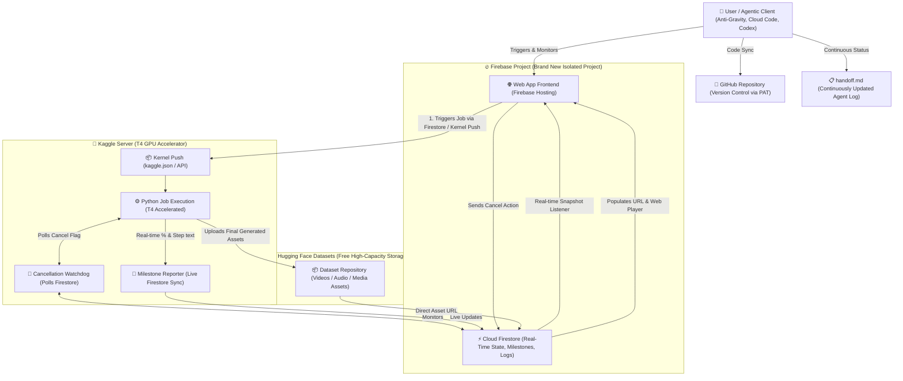

# Epic Automate: The Custom Automation Architecture Blueprint

`epic-automate` defines the standard **Modus Operandi** for designing, scaffolding, and executing high-scale AI and data automation systems. Whenever an AI agent is tasked with building an automation (triggered by `/epic-automate`, `/epic automate`, or phrases like *"I want to create an automation"* or *"I want to create a particular automation"*), it must follow this exact architectural framework, confirm all defaults with the user, and enforce every operational principle outlined below.

---

## 1. System Architecture Overview



---

## 2. The 7 Foundational Pillars

### Pillar 1: Compulsory Brand New Firebase Project for Frontend
- **Rule**: Every new automation must be deployed to a **brand-new Firebase project** on the user's Firebase account.
- **Strict Exception Policy**: Never reuse existing Firebase projects unless the user explicitly commands it.
- **Why**: Ensures each automation has a completely isolated live URL, isolated quota, independent environment, and dedicated Firestore rules.
- **Tooling**: Use Firebase CLI (`firebase login`, `firebase projects:create <project-id>`, `firebase use <project-id>`, `firebase deploy`) or Firebase MCP.

### Pillar 2: Firestore for Lightweight Real-Time State & Milestones
- **Purpose**: Fast, low-latency document storage for execution states, tabular metadata, live progress metrics, logs, and asset URLs.
- **Constraint**: **Never** store large raw binary assets (heavy videos, raw audio tracks, massive model weights) in Firestore.
- **Schema standard**: Each job maintains a document under `/automations/{jobId}` containing:
  - `status`: `"queued"` | `"running"` | `"completed"` | `"failed"` | `"cancelled"`
  - `progress`: Integer `0` to `100` (percentage)
  - `current_milestone`: Human-readable description of current task (e.g. *"Generating Scene 3 audio with Kokoro TTS..."*)
  - `logs`: Array of timestamped log entries
  - `cancel_requested`: Boolean (`false` by default, set to `true` when user hits Cancel)
  - `asset_url`: Direct download URL from Hugging Face Datasets
  - `asset_type`: `"video"` | `"audio"` | `"image"` | `"archive"`
  - `created_at` & `updated_at`: Timestamps

### Pillar 3: Kaggle T4 GPU Compute Server & Mandatory Research Rule
- **Accelerator**: Kaggle's free T4 GPU tier provides heavy acceleration for AI generation, video rendering (FFmpeg / HyperFrames), model inference, and batch processing.
- **MANDATORY RESEARCH RULE**: Kaggle frequently modifies its CLI specifications, metadata syntax, and accelerator keywords (e.g., `enable_gpu: true`, `accelerator: "nvidiaTeslaT4"`, or `gpu_type: "nvidia-tesla-t4"`). The agent **MUST research specifically every single time** prior to generating `kernel-metadata.json` to verify the latest accepted format for triggering the T4 accelerator.
- **Trigger**: Pushed via Kaggle CLI (`kaggle kernels push -p <kernel_folder>`) using the user's Kaggle credentials (`kaggle.json` or `KAGGLE_USERNAME` and `KAGGLE_KEY`).

### Pillar 4: Real-Time Milestone Streaming & Frontend Progress UI
- **Live Stream**: As the Kaggle Python script processes milestones (e.g., downloading inputs, running neural models, stitching video clips, encoding, uploading), it synchronously pushes updates to the Firestore job document.
- **Frontend Presentation**:
  - **Dynamic Progress Bar**: Smooth percentage progression (0% → 100%).
  - **Milestone Subtitle**: Exact status text indicating what step was just finished and what is currently running.
  - **Live Terminal/Log Console**: Auto-scrolling transcript of operations and warnings.

### Pillar 5: Interruptible Cancellation Engine
- **Requirement**: If the user presses the "Cancel" button on the web app for a running job, execution must terminate immediately.
- **Dual-Layer Cancellation Logic**:
  1. **Firestore Cancel Flag**: The UI writes `cancel_requested: true` and `status: "cancelled"` to Firestore.
  2. **Kaggle Watchdog / Step Verification**: The Kaggle Python job runs a lightweight background watchdog thread (or checks before every loop/milestone) that inspects Firestore. If `cancel_requested == True`:
     - Kills any child processes (FFmpeg, subprocesses).
     - Cleans up temporary files.
     - Logs `"Execution cancelled by user"`.
     - Exits immediately (`sys.exit(0)`).
  3. **Kaggle CLI Abort** (optional trigger backup): If feasible, trigger `kaggle kernels status` and cancel via API.

### Pillar 6: Hugging Face Datasets for Free Asset Storage & Web Media Preview
- **Free High-Capacity Storage**: Hugging Face Datasets provides generous, persistent storage without cloud egress or hosting bills.
- **Upload**: The Kaggle worker uses `huggingface_hub` (`HfApi.upload_file` or `upload_folder`) with the user's or builder's `HF_TOKEN` to store the generated assets in a designated dataset repository (e.g., `username/automation-assets`).
- **Web Media Preview**:
  - The direct Hugging Face raw file URL (e.g., `https://huggingface.co/datasets/<user>/<repo>/resolve/main/<filename>`) is written back to Firestore.
  - The web UI receives this URL in real-time.
  - The user can click a **"Copy Asset URL"** button.
  - For video or audio outputs, the UI renders an embedded **HTML5 Web Media Player** with controls (play, pause, volume, fullscreen) so the user can preview the result directly inside the app!

### Pillar 7: GitHub Code Versioning & Continuous `handoff.md` Protocol
- **GitHub Versioning**:
  - All source code (frontend, Kaggle scripts, metadata, deployment configs) is pushed to the user's GitHub repository using their GitHub Personal Access Token (PAT).
  - The repository link is provided directly to the user upon completion.
- **Living `handoff.md` File**:
  - The agent must create and continuously maintain a `handoff.md` file in the project root.
  - Any subsequent agent or collaborator reading the project immediately understands:
    - Current accomplishment and milestones reached.
    - Modifications and code changes made so far.
    - Live URLs (Firebase web app, GitHub repo, Hugging Face dataset, Kaggle kernel).
    - Status of all credentials and secrets.
    - Exact instructions for the next agent to resume without context loss.

---

## 3. Skill Invocation & Novice-Friendly Credential Onboarding

When triggered (`/epic-automate` or user mentions creating an automation):

### Phase 1: Confirmation & Architecture Alignment
1. Greet the user and introduce the **Epic Automate** modus operandi.
2. Outline the standard 5-part stack:
   - **Frontend**: New Firebase Web App (Firebase Hosting)
   - **Database**: Cloud Firestore (Real-time progress, milestones, logs)
   - **Compute**: Kaggle Server with T4 GPU (Kernel push)
   - **Storage**: Hugging Face Datasets (Free media assets + web preview)
   - **Code & Handoff**: GitHub Repo + continuous `handoff.md`
3. Ask the user:
   > *"Would you like to proceed with the standard Epic Automate architecture, or do you have any specific changes or custom preferences for this automation?"*

---

### Phase 2: Comprehensive Novice-Proof Credential Audit

The agent **must first audit** what credentials and access tokens are already available in the environment, present a scorecard table, and guide the user on obtaining any missing items with step-by-step instructions.

#### The 4 Essential Access Tokens & Credentials:
1. **GitHub Personal Access Token (PAT)**: With full `repo` write access for version control.
2. **Hugging Face Token**: With `Write` access to upload generated assets to Hugging Face Datasets.
3. **Kaggle Username & Token**: Kaggle API token (`kaggle.json` or username + API key) to trigger the T4 GPU.
4. **Firebase Access**: Authenticated Firebase session via Firebase CLI (`firebase login`) or Firebase MCP to provision a new project and deploy Hosting + Firestore.

#### The Credential Scorecard Presentation:
```markdown
### 🔑 Epic Automate Credential Check
| Service | Required Token / Access | Status | Action Required |
|---|---|---|---|
| **GitHub** | PAT with full `repo` write access | 🟢 Detected / 🔴 Missing | [Instructions below if missing] |
| **Hugging Face** | Token with `Write` scope | 🟢 Detected / 🔴 Missing | [Instructions below if missing] |
| **Kaggle** | Username + API Key (`kaggle.json`) | 🟢 Detected / 🔴 Missing | [Instructions below if missing] |
| **Firebase** | CLI Authenticated (`firebase login`) | 🟢 Connected / 🔴 Missing | [Instructions below if missing] |
```

#### Novice-Friendly Guides for Missing Credentials:

##### 🐙 1. GitHub Personal Access Token (PAT)
If missing or lacking write access:
1. Go to [github.com/settings/tokens](https://github.com/settings/tokens).
2. Click **Generate new token** -> Select **Generate new token (classic)**.
3. Enter Note: `Epic Automate Token`.
4. Expiration: Select `90 days` or `No expiration`.
5. Under Select scopes, check **`repo`** (Full control of private repositories, code, commits, webhooks).
6. Click **Generate token** at the bottom.
7. Copy the token (starts with `ghp_...`) and paste it here in the chat or save it to your `GITHUB_TOKEN` environment variable.

##### 🤗 2. Hugging Face Access Token
If missing:
1. Log in to [huggingface.co](https://huggingface.co).
2. Go to **Settings** -> **Access Tokens** ([huggingface.co/settings/tokens](https://huggingface.co/settings/tokens)).
3. Click **Create new token**.
4. Name: `Epic Automate Storage`.
5. Token type: Select **Write** (required to create datasets and upload files).
6. Click **Generate a token**, copy the token (starts with `hf_...`), and paste it here in chat.

##### 🚀 3. Kaggle Username & API Token
If missing:
1. Log in to [kaggle.com](https://www.kaggle.com).
2. Click your profile avatar in the top right -> Select **Settings** ([kaggle.com/settings](https://www.kaggle.com/settings)).
3. Scroll down to the **API** section.
4. Click **Create New Token**. This downloads a file named `kaggle.json`.
5. Open `kaggle.json` in Notepad. It will look like:
   ```json
   {"username":"your_username","key":"abcdef0123456789..."}
   ```
6. Either place `kaggle.json` inside `C:\Users\<username>\.kaggle\kaggle.json` (or `~/.kaggle/kaggle.json`), or provide your username and key in the chat.

##### 🔥 4. Firebase Authentication
If not authenticated:
1. Open your terminal and run:
   ```powershell
   firebase login
   ```
2. A browser tab will open asking you to sign in with your Google account.
3. Grant permissions and return to the terminal.
4. Confirm by running:
   ```powershell
   firebase projects:list
   ```
5. If running inside a headless environment without browser launch, use `firebase login --no-localhost`.

---

### Phase 3: Provision Compulsory New Firebase Project
1. Run `firebase projects:create <project-id>` (or use Firebase MCP).
2. Initialize Firebase Hosting and Cloud Firestore in the new project.
3. Generate `firebase.json` and Firestore security rules.

---

### Phase 4: Research Kaggle T4 GPU Specification
1. Conduct targeted research/verification of Kaggle's latest kernel metadata API format.
2. Verify settings:
   - `enable_gpu: true`
   - Accelerator specification (`accelerator`: `"nvidiaTeslaT4"` or latest CLI equivalent).
   - Python version & environment image.

---

### Phase 5: Implement Real-Time Engine & Cancellation Logic
1. Build the Kaggle Python executor using the template in `templates/kaggle_executor.py`.
2. Connect Firestore Admin SDK (or REST API) inside the Kaggle script for real-time milestone streaming.
3. Launch the cancellation watchdog thread.

---

### Phase 6: Deploy Frontend with Live Progress, Cancel Button & Media Preview
1. Deploy the web frontend (see `templates/frontend/`) to Firebase Hosting.
2. Features:
   - Job trigger input.
   - Dynamic progress bar (% 0-100).
   - Live milestone text indicator.
   - Immediate "Cancel Execution" button.
   - Live log window.
   - Hugging Face asset link copy button.
   - Embedded HTML5 Video/Audio preview player.

---

### Phase 7: Push to GitHub & Maintain `handoff.md`
1. Initialize Git, create remote on GitHub using user's PAT.
2. Commit and push all project files.
3. Write and update `handoff.md` with complete architecture details and URLs.
4. Output the final live Firebase URL and GitHub repo link.

---

## 4. Reference Implementations & Templates

### A. Kaggle Kernel Metadata Template (`kernel-metadata.json`)
```json
{
  "id": "YOUR_KAGGLE_USERNAME/automation-job-worker",
  "title": "Automation Job Worker",
  "code_file": "kaggle_executor.py",
  "language": "python",
  "kernel_type": "script",
  "is_private": "true",
  "enable_gpu": "true",
  "enable_tpu": "false",
  "accelerator": "nvidiaTeslaT4",
  "enable_internet": "true",
  "dataset_sources": [],
  "competition_sources": [],
  "kernel_sources": [],
  "model_sources": []
}
```
*(Always run research on Kaggle API docs before kernel push to confirm accelerator flag naming).*

### B. Python Real-Time Milestone & Cancellation Worker (`kaggle_executor.py`)
```python
import os
import sys
import time
import threading
import requests
from huggingface_hub import HfApi

# Configuration from environment or injected args
FIRESTORE_PROJECT_ID = os.environ.get("FIREBASE_PROJECT_ID")
JOB_ID = os.environ.get("JOB_ID")
HF_TOKEN = os.environ.get("HF_TOKEN")
HF_DATASET_REPO = os.environ.get("HF_DATASET_REPO") # e.g. "username/epic-assets"

cancel_event = threading.Event()

def update_firestore(progress_pct, milestone_text, status="running", asset_url=None, logs_append=None):
    """Updates Firestore document via REST API to eliminate heavy client library overhead."""
    url = f"https://firestore.googleapis.com/v1/projects/{FIRESTORE_PROJECT_ID}/databases/(default)/documents/automations/{JOB_ID}"
    fields = {
        "progress": {"integerValue": str(progress_pct)},
        "current_milestone": {"stringValue": milestone_text},
        "status": {"stringValue": status},
        "updated_at": {"stringValue": time.strftime("%Y-%m-%dT%H:%M:%SZ", time.gmtime())}
    }
    if asset_url:
        fields["asset_url"] = {"stringValue": asset_url}
        fields["asset_type"] = {"stringValue": "video"}
    
    # Patch document
    update_mask = "updateMask.fieldPaths=progress&updateMask.fieldPaths=current_milestone&updateMask.fieldPaths=status&updateMask.fieldPaths=updated_at"
    if asset_url:
        update_mask += "&updateMask.fieldPaths=asset_url&updateMask.fieldPaths=asset_type"
        
    try:
        requests.patch(f"{url}?{update_mask}", json={"fields": fields}, timeout=5)
    except Exception as e:
        print(f"[Warning] Firestore update failed: {e}")

def cancellation_watchdog():
    """Continuously polls Firestore to check if the user clicked Cancel on the frontend."""
    url = f"https://firestore.googleapis.com/v1/projects/{FIRESTORE_PROJECT_ID}/databases/(default)/documents/automations/{JOB_ID}"
    while not cancel_event.is_set():
        try:
            resp = requests.get(url, timeout=5)
            if resp.status_code == 200:
                data = resp.json().get("fields", {})
                cancel_requested = data.get("cancel_requested", {}).get("booleanValue", False)
                if cancel_requested:
                    print("\n[ALERT] Cancel request detected from user! Aborting Kaggle worker immediately...")
                    cancel_event.set()
                    update_firestore(progress_pct=0, milestone_text="Cancelled by user", status="cancelled")
                    os._exit(0)
        except Exception:
            pass
        time.sleep(3)

def check_cancel():
    if cancel_event.is_set():
        print("[Cancelled] Halting execution.")
        sys.exit(0)

def main():
    print(f"Starting Epic Automate execution for Job ID: {JOB_ID}")
    
    # Start watchdog thread
    watchdog = threading.Thread(target=cancellation_watchdog, daemon=True)
    watchdog.start()

    # Step 1: Initialization
    check_cancel()
    update_firestore(5, "Initializing GPU environment & loading model checkpoints...")
    time.sleep(2)

    # Step 2: Processing Heavy Tasks
    check_cancel()
    update_firestore(30, "Generating voiceover and neural assets...")
    time.sleep(3)

    # Step 3: Video Assembly
    check_cancel()
    update_firestore(65, "Rendering and assembling video with FFmpeg/HyperFrames...")
    output_filename = "final_output.mp4"
    # (Simulated generation for demonstration; real worker writes actual file)
    with open(output_filename, "wb") as f:
        f.write(b"SAMPLE_VIDEO_BYTES")

    # Step 4: Hugging Face Upload
    check_cancel()
    update_firestore(85, "Uploading generated media to Hugging Face Datasets...")
    
    api = HfApi(token=HF_TOKEN)
    api.create_repo(repo_id=HF_DATASET_REPO, repo_type="dataset", exist_ok=True)
    remote_path = f"outputs/{JOB_ID}/{output_filename}"
    api.upload_file(
        path_or_fileobj=output_filename,
        path_in_repo=remote_path,
        repo_id=HF_DATASET_REPO,
        repo_type="dataset"
    )
    
    # Direct raw download URL
    hf_download_url = f"https://huggingface.co/datasets/{HF_DATASET_REPO}/resolve/main/{remote_path}"
    
    # Step 5: Completion
    check_cancel()
    update_firestore(100, "Automation finished successfully!", status="completed", asset_url=hf_download_url)
    print(f"Job completed successfully. Asset URL: {hf_download_url}")

if __name__ == "__main__":
    main()
```

### C. Standardized `handoff.md` Structure
Every project must contain this document, updated at each phase:

```markdown
# Epic Automate Project Handoff

## 1. Project Overview & Modus Operandi
- **Automation Name**: [Name]
- **Created**: [Timestamp]
- **Last Modified**: [Timestamp]
- **Modus Operandi**: Epic Automate standard (New Firebase + Firestore + Kaggle T4 + Hugging Face Datasets + GitHub)

## 2. Infrastructure & Live Endpoints
- **Firebase Project ID**: `[project-id]`
- **Live Frontend URL**: `https://[project-id].web.app`
- **Firestore Collection**: `/automations/{jobId}`
- **Kaggle Kernel**: `https://www.kaggle.com/[username]/[kernel-slug]`
- **Kaggle GPU Tier**: T4 GPU (`nvidiaTeslaT4`)
- **Hugging Face Dataset**: `https://huggingface.co/datasets/[username]/[dataset-name]`
- **GitHub Repository**: `https://github.com/[username]/[repo-name]`

## 3. Credentials & Secrets Checklist
| Credential | Status | Configured In | Notes |
|---|---|---|---|
| Firebase Auth | Connected | CLI / Firebase App | Logged into dedicated project |
| Kaggle API | Connected | `kaggle.json` / Env | Tested kernel push |
| Hugging Face Token | Connected | `HF_TOKEN` | Write access to datasets |
| GitHub PAT | Connected | `GITHUB_TOKEN` | Push access verified |

## 4. Current State & Modifications Completed
- [x] Initialized new Firebase project and deployed hosting frontend.
- [x] Built Firestore real-time progress & cancel listener.
- [x] Tested Kaggle T4 kernel push.
- [x] Verified cancellation watchdog.
- [x] Tested Hugging Face dataset asset upload and web media player preview.
- [x] Synced all codebase commits to GitHub.

## 5. Instructions for Next Agent
- To run or trigger a new job: Trigger via the web app at `https://[project-id].web.app` or run `kaggle kernels push`.
- To alter the compute pipeline: Modify `kaggle_executor.py` and repush to Kaggle.
- Remember to maintain this `handoff.md` file whenever making updates.
```
