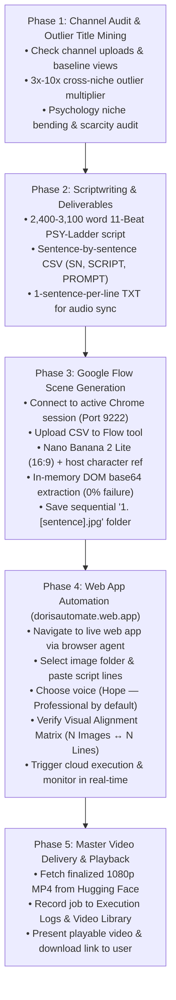

# Doris — Master YouTube Video Production Pipeline

The unified, end-to-end autonomous channel automation skill. Orchestrates the complete YouTube lifecycle from initial channel research to final 1080p sentence-synchronized video delivery:



---

## Trigger Invocations

Activate this skill whenever the user says:
- `"/doris"`
- `"/doris generate for me a video for my channel"`
- `"/doris generate a video for [channel_url]"`
- *"Doris, generate for me a video for my channel"*
- *"Run the Doris pipeline to create a video for my channel"*
- *"Generate a complete video from scratch for my channel"*

---

## Required Tool Bindings & Endpoints

| Resource | Identifier / Endpoint | Purpose |
|---|---|---|
| **Live Automation Web App** | `https://dorisautomate.web.app` | Asset ingestion, visual alignment, voice selection & cloud video assembly |
| **Google Flow Tool** | `https://flow.google.com/shared/tool/ee8f4722-38cb-4363-967f-057725e7c3c6` | High-throughput batch 2D animation scene generation |
| **Active Chrome Window** | Remote Debugging on `localhost:9222` | Authenticated session for Flow and web app interaction |
| **Hugging Face Datasets** | `Dorisautomate/automation-assets` | Cloud asset storage, voice references & rendered master MP4s |
| **Kaggle GPU Accelerator** | `dorisautomate/doris-storyteller-worker` (T4 GPU) | F5-TTS zero-shot voice synthesis & FFmpeg video stitching |
| **Default Voice Profile** | `✨ Hope — Professional, Clear & Natural` | Cloned from ElevenLabs reference recording via F5-TTS |

---

## Detailed 5-Phase Production Protocol

### Phase 1: Channel Audit & Outlier Title Mining

If the user provides a channel link (e.g., `https://youtube.com/@...` or channel name), audit the channel to tailor the concept to their audience:

1. **Channel Audit**:
   - Inspect the channel's recent 10–20 uploads using web search or Chrome DevTools.
   - Calculate the channel's **Baseline / Median Views** over the last 90 days.
   - Note top-performing themes, audience pain points, and current character/visual style.
2. **Outlier Mining**:
   - Scan adjacent high-performing niches (Personal Finance, Tech, Investigative Documentaries, Fitness).
   - Identify candidate breakout videos with an **Outlier Multiplier of $3.0\text{x}$ to $10.0\text{x}+$**:
     $$\text{Outlier Multiplier} = \frac{\text{Candidate Video Views}}{\text{Candidate Channel Median Views}}$$
3. **Psychology Niche Bending**:
   - Extract the viral psychological tension (e.g. status anxiety, boundary defense, cognitive dissonance, counterfeit virtue).
   - Bend the syntax into depth psychology (Jungian shadow, vagal brake, prefrontal regulation, unshakeable composure).
4. **Scarcity & Search Demand Audit**:
   - Audit YouTube search for exact matches; enforce a Scarcity Score of **4 or 5 out of 5** (near-zero direct competition).
   - Confirm strong organic search intent.
   - Select the winning outlier title (e.g., *"The 6 Mental Levels Where People-Pleasing Turns Into Quiet Power"*).

---

### Phase 2: Scriptwriting & Deliverables Generation

Execute the full long-form psychology script adhering strictly to the **PSY-Ladder Outlier System**:

1. **Script Parameters**:
   - **Length**: 2,400 to 3,100 words (Target: ~2,850 words; 14–16 minutes spoken).
   - **Perspective**: 90% 2nd-person ("You"), 10% anchor character (Daniel) + cited scientific researchers (Author, Institution, Year).
   - **Structure**: 11 mandatory psychological beats (Hook, Stay Line, Pain Deepening, Science Reversal, Ladder Map, Levels 1–2 Trap, Levels 3–4 Turn, Levels 5–6 Apex, 3 Objections Knockdown, The One Tool Install, Payoff & Level Confession CTA).
   - **TTS Pacing**: Short, punchy sentences (8–14 words average). No em dashes (`—`) in spoken lines; use commas and periods.

2. **Sentence-by-Sentence CSV Export**:
   - Deconstruct every single sentence into a CSV row with exact capitalized columns: `SN,SCRIPT,PROMPT`.
   - **Prompt Formula**:
     > `[Subject action with original character + props/infographics], 2D adult animated sitcom aesthetic, bold thick black outlines, flat solid colors, plain solid white background`
   - **Character Anchor**: Always reference `A cartoon man with glasses in a navy sweater over a white collared shirt`.
   - **Policy Guardrails**: No copyrighted show names (use *"2D adult animated sitcom aesthetic"*), no self-harm/despair tropes, no dark car interiors at night, no violent or damage words.

3. **1-Sentence-Per-Line TXT Export**:
   - Save a companion `.txt` file where line $N$ matches row $N$ of the CSV verbatim.
   - Save both files to `C:\Users\doris\Downloads\<Title_Slug>.csv` and `.txt`.

---

### Phase 3: Google Flow Scene Generation

Batch-generate all visual frames using the user's authenticated Google Chrome session:

1. **Connect & Navigate**:
   - Attach browser agent to active Chrome (`localhost:9222`).
   - Navigate to Google Flow: `https://flow.google.com/shared/tool/ee8f4722-38cb-4363-967f-057725e7c3c6`.
   - Switch context to the tool iframe.
2. **Configure Generation Parameters**:
   - Upload the generated CSV from `C:\Users\doris\Downloads\<Title_Slug>.csv`.
   - Select Model: **`🍌 Nano Banana 2 Lite`** (high throughput ~2-3s per scene, crisp vector outlines).
   - Set Aspect Ratio: **`16:9`** (landscape standard).
   - Upload Host Character Reference: `my_character_reference.png`.
3. **Execute Batch Generation**:
   - Click **"Generate All"** and monitor batch progress until 100% complete.
4. **In-Memory DOM Image Extraction (Zero Download Errors)**:
   > [!IMPORTANT]
   > Do **NOT** use browser bulk downloads (triggers Windows AES / Chrome "Virus scan failed" file lock errors).
   - Extract image base64 payloads directly from the DOM using DevTools evaluation:
     ```javascript
     (() => {
       const imgs = Array.from(document.querySelectorAll('img'))
         .filter(img => img.alt !== 'Style Ref' && img.src.startsWith('data:image'));
       return imgs.map((img, idx) => ({ sn: idx + 1, src: img.src }));
     })();
     ```
   - Decode base64 payloads directly to disk in `C:\Users\doris\Downloads\<Title_Folder>\`.
   - Apply strict sequential naming:
     $$\mathbf{<SN>.\ <Sentence>.jpg}$$
     *(e.g., `1. It is Thursday night, and you are sitting in your car with the headlights off.jpg`)*.

---

### Phase 4: Web App Automation (`dorisautomate.web.app`)

Automate the video compilation directly on the live production web app:

1. **Navigate**:
   - Open **`https://dorisautomate.web.app`** in the active Chrome session.
2. **Step 1 — Folder Ingestion**:
   - Select the folder containing the downloaded scene images (`C:\Users\doris\Downloads\<Title_Folder>`).
   - Confirm the badge shows: `📁 Loaded N images sorted in numerical sequence`.
3. **Step 2 — Voice Model Selection**:
   - Verify **`✨ Hope — Professional, Clear & Natural (Default)`** is selected (or switch to `✨ Hope — Upbeat & Clear` / `🎙️ Doris Voice` if specified).
4. **Step 3 — Script Ingestion**:
   - Read the 1-sentence-per-line `.txt` file from `C:\Users\doris\Downloads\<Title_Slug>.txt`.
   - Paste the complete text into `#scriptInput`.
   - Confirm the line counter badge matches the image count ($N$ Lines).
5. **Step 4 — Alignment Matrix Verification**:
   - Inspect `#alignmentBadge`. Verify it displays:
     `🟢 Aligned: N Images ↔ N Sentences`
   - Ensure `#runBtn` is enabled.
6. **Step 5 — Trigger Execution & Real-Time Tracking**:
   - Click `#runBtn` ("Run Video Automation").
   - Monitor the execution logs and progress bar in real time:
     - `[CLOUD] 100% Cloud Architecture engaged`
     - `[GITHUB] Dispatching cloud workflow runner on GitHub Actions`
     - `[KAGGLE] Cloud runner spinning up Kaggle T4 GPU worker (NvidiaTeslaT4)`
     - Poll until `[DONE] Generated video received from Kaggle server via Hugging Face`.

---

### Phase 5: Master Video Delivery & Playback

1. **Retrieve Video Asset**:
   - Extract the master 1080p MP4 URL from Hugging Face Datasets repository (`https://huggingface.co/datasets/Dorisautomate/automation-assets/resolve/main/videos/...`).
2. **Library Registration**:
   - Verify that the execution entry appears in the web app's **Execution Logs & History** tab with status `🟢 Completed`.
3. **Present Final Deliverable to User**:
   - Deliver a formatted completion briefing in chat:
     - **Video Title & Topic Angle**
     - **Channel Attribution**
     - **Voice Profile Used**: (e.g. Hope Professional, Clear & Natural)
     - **Total Scenes / Images**: (e.g. 180 scenes)
     - **Total Script Word Count & Estimated Runtime**: (e.g. 2,850 words / 15 mins 40 secs)
     - **Direct Playable Video Link**: [Watch Video](https://huggingface.co/datasets/Dorisautomate/automation-assets/resolve/main/videos/hope_professional_story_video.mp4)
     - **Direct MP4 Download Link**
     - **Live Web App Dashboard**: [https://dorisautomate.web.app](https://dorisautomate.web.app)

---

## Standard Operating Procedures for Subsequent Agents

1. **Always use active Chrome (Port 9222)**: Never launch a separate unauthenticated headless browser.
2. **Enforce 1:1 Image-to-Sentence parity**: Every image must strictly correspond to its numbered script sentence.
3. **Always use `dorisautomate.web.app` as the primary live compiler**: Do not run manual local FFmpeg commands unless specifically requested as an offline fallback.
4. **Default voice is always Hope Professional**: Unless the user explicitly asks for Doris Voice or Hope Upbeat.
