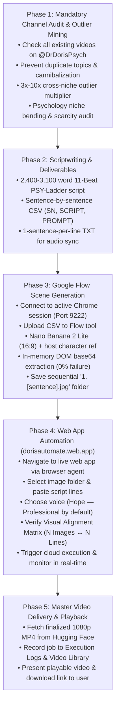

# Doris — Master YouTube Video Production Pipeline

The unified, 100% autonomous channel production skill specifically configured for **[Dr Doris Psych](https://www.youtube.com/@DrDorisPsych)**.

> [!IMPORTANT]
> ### Strict Process Adherence & Zero Improvisation Mandate
> Once triggered, this skill **MUST NOT STOP, PAUSE, OR IMPROVISE**.
> - **NEVER IMPROVISE OR BYPASS ANY STAGE**: The agent **MUST** follow every step of this pipeline literally and strictly.
> - **CANONICAL CHARACTER MODEL SHEET**: Every Flow generation must use the official channel host character model sheet located at:
>   `C:\Users\doris\Downloads\Doris Automation\assets\doris_character_reference_sheet.png` (mirror at `C:\Users\doris\Downloads\doris_character_reference_sheet.png`).
>   Never generate without uploading this exact reference sheet into the Flow project.
> - **RICH ENVIRONMENTAL PROMPTS (NO BLANK BACKGROUNDS)**: Characters must NEVER be isolated on a plain white background. Every prompt must describe the character, the specific action, and a rich, detailed environment corresponding directly to what is happening in the sentence narrative (e.g. corporate glass conference room, rainy evening car interior, psychology consultation office, university lecture hall, illuminated neuroscience lab).
> - **BROWSER AGENT EXECUTION (NO HARDCODED TIMEOUT SCRIPTS)**: Google Flow generation must be driven by an active **Browser Agent** inspecting the UI visually, uploading the character reference sheet, monitoring scene cards, and actively clicking the **Retry** button on any failed scene until 100% of rows are green. Never use a blind script with a premature timeout (e.g., 20-minute limit on a 170-scene video).
> - **NO IMAGE RECYCLING**: Never reuse or copy images from previous runs or older project folders. Every single video requires fresh scene frames batch-generated through Google Flow.
> - **100% CLOUD VIDEO COMPILATION ON WEB APP (NEVER LOCAL FFMPEG STITCHING)**: Assembly and rendering must be automated on `https://dorisautomate.web.app` using the Kaggle T4 GPU worker container and cloud orchestrator. Never stitch images locally on the desktop with FFmpeg demuxer.
> - **STRICT DURATION CALIBRATION**: If a 1-minute video is requested, the script must be a full 60 seconds (150–240 words, 14–16 sentences). If a 15-minute video is requested, the script must be 2,400–3,100 words (160–190 sentences).
> - The agent **must autonomously execute all 5 phases sequentially in one continuous run**, auto-resolving any minor hurdles, and only concluding when the finalized, synchronized 1080p master video is delivered.



---

## Trigger Invocations

Activate this skill whenever the user says:
- `"/doris"`
- `"/doris generate for me a video for my channel"`
- *"Doris, generate for me a video for my channel"*
- *"Run the Doris pipeline to create a video for Dr Doris Psych"*
- *"Generate a complete video from scratch for my channel"*

---

## Required Tool Bindings & Endpoints

| Resource | Identifier / Endpoint | Purpose |
|---|---|---|
| **Official YouTube Channel** | **[Dr Doris Psych (`https://www.youtube.com/@DrDorisPsych`)](https://www.youtube.com/@DrDorisPsych)** | Embedded anchor channel for duplicate prevention, style alignment & performance baseline |
| **Live Automation Web App** | `https://dorisautomate.web.app` | Asset ingestion, visual alignment, voice selection & cloud video assembly |
| **Google Flow Tool** | `https://flow.google.com/shared/tool/ee8f4722-38cb-4363-967f-057725e7c3c6` | High-throughput batch 2D animation scene generation |
| **Active Browser Window** | Remote Debugging on `localhost:9222` | Authenticated session (Edge or Chrome) for Flow and web app interaction |
| **Hugging Face Datasets** | `Dorisautomate/automation-assets` | Cloud asset storage, voice references & rendered master MP4s |
| **Kaggle GPU Accelerator** | `dorisautomate/doris-storyteller-worker` (T4 GPU) | F5-TTS zero-shot voice synthesis & FFmpeg video stitching |
| **Default Voice Profile** | `✨ Hope — Professional, Clear & Natural` | Cloned from ElevenLabs reference recording via F5-TTS |

---

## Detailed 5-Phase Continuous Production Protocol

### Phase 1: Mandatory Channel Audit & Outlier Title Mining

> [!IMPORTANT]
> **Duplicate Prevention Protocol**:
> Before formulating any new topic or writing any script, the agent **MUST FIRST** check all videos currently published on the official channel:
> **`https://www.youtube.com/@DrDorisPsych`**
> Catalog every published title and subject angle to ensure the new video is 100% novel, does not repeat existing lessons, and does not compete with existing uploads.

1. **Step 1 — Audit Existing Channel Uploads**:
   - Navigate to `https://www.youtube.com/@DrDorisPsych/videos` (or search for the channel's published catalog using web search or Chrome DevTools).
   - Log all published video titles, thumbnail themes, and viewer view counts.
   - Establish the channel's **Baseline / Median Views** over the last 90 days.
   - Identify which topics produced above-average viewer retention and comments.
2. **Step 2 — Identify Unaddressed White-Space Topics**:
   - Cross-reference the channel's existing library against audience requests in comments and high-search-intent psychology queries.
   - Disqualify any candidate concept that substantially overlaps with an existing video on `@DrDorisPsych`.
3. **Step 3 — Cross-Niche Outlier Mining**:
   - Scan adjacent non-psychology niches (Personal Finance, Business, Tech Documentaries, Fitness, True Crime).
   - Filter for breakout videos achieving an **Outlier Multiplier of $3.0\text{x}$ to $10.0\text{x}+$**:
     $$\text{Outlier Multiplier} = \frac{\text{Candidate Video Views}}{\text{Candidate Channel Median Views}}$$
4. **Step 4 — Psychology Niche Bending**:
   - Extract the core psychological syntax (status anxiety, boundary defense, cognitive dissonance, counterfeit virtue, silent leverage).
   - Bend the syntax into depth psychology (Jungian shadow, vagal brake, prefrontal regulation, unshakeable composure).
5. **Step 5 — YouTube Scarcity Audit & Final Title Selection**:
   - Verify that YouTube has near-zero direct competition on the coined title (Scarcity Score of **4 or 5 out of 5**).
   - Confirm search intent, lock the winning title, and **immediately transition to Phase 2 without pausing for user approval**.

---

### Phase 2: Scriptwriting & Deliverables Generation

Execute the full long-form psychology script adhering strictly to the **PSY-Ladder Outlier System**:

1. **Script Parameters**:
   - **Length**: 2,400 to 3,100 words (Target: ~2,850 words; 14–16 minutes spoken).
   - **Perspective**: 90% 2nd-person ("You"), 10% anchor character (Daniel) + cited scientific researchers (Author, Institution, Year).
   - **Structure**: 11 mandatory psychological beats (Hook, Stay Line, Pain Deepening, Science Reversal, Ladder Map, Levels 1–2 Trap, Levels 3–4 Turn, Levels 5–6 Apex, 3 Objections Knockdown, The One Tool Install, Payoff & Level Confession CTA).
   - **TTS Pacing**: Short, punchy sentences (8–14 words average). No em dashes (`—`) in spoken lines; use commas and periods.

2. **Sentence-by-Sentence CSV Export**:
   - Deconstruct every single sentence into a CSV row with exact capitalized columns: `SN,SCRIPT,PROMPT`.
   - **Rich Environmental Prompt Formula (NO Blank White Backgrounds)**:
     > `[Subject action with original character + props/infographics], in [rich, specific environment matching the sentence narrative e.g. glass conference room with long table, psychology consultation office with full bookshelves and armchair, rainy evening car interior with glowing dashboard dials, university lecture hall, illuminated neuroscience lab with brain diagram], 2D adult animated sitcom aesthetic, bold thick black outlines, flat solid vibrant colors, detailed atmospheric environment`
   - **Character Anchor**: Always reference `A cartoon man with glasses in a navy sweater over a white collared shirt` (host Daniel).
   - **Environment Requirement**: Every prompt must vividly describe the setting of the scene. Never produce blank, plain white backgrounds or characters floating in void.
   - **Policy Guardrails**: No copyrighted show names (use *"2D adult animated sitcom aesthetic"*), no self-harm/despair triggers, no violent or damage words. Use constructive visual metaphors.

3. **1-Sentence-Per-Line TXT Export**:
   - Save a companion `.txt` file where line $N$ matches row $N$ of the CSV verbatim.
   - Save both files to `C:\Users\doris\Downloads\<Title_Slug>.csv` and `.txt`.
   - **Immediately transition to Phase 3 without pausing**.

---

### Phase 3: Google Flow Scene Generation (Browser Agent Driven)

Batch-generate all visual frames using an interactive **Browser Agent** connected to the user's authenticated Google Chrome session:

1. **Connect & Navigate**:
   - Attach browser agent to active Chrome (`localhost:9222`).
   - Navigate to Google Flow: `https://flow.google.com/shared/tool/ee8f4722-38cb-4363-967f-057725e7c3c6`.
   - Switch context to the tool iframe.
2. **Upload Character Model Sheet Reference**:
   - Every Flow session must attach the official channel character reference sheet:
     `C:\Users\doris\Downloads\Doris Automation\assets\doris_character_reference_sheet.png` (mirror: `C:\Users\doris\Downloads\doris_character_reference_sheet.png`).
   - This anchors character anatomy, clothing, and vector style across all 16:9 frames.
3. **Configure Generation Parameters**:
   - Upload the generated CSV from `C:\Users\doris\Downloads\<Title_Slug>.csv`.
   - Select Model: **`🍌 Nano Banana 2 Lite`** (high throughput, crisp vector outlines).
   - Set Aspect Ratio: **`16:9`** (landscape standard).
4. **Execute Batch Generation & Interactive Monitoring**:
   - Click **"Run Batch"** / **"Generate All"**.
   - **No Hardcoded Timeout Scripts**: For a 15-minute video (160–190 scenes), batch generation requires ~40–50 minutes. The browser agent must monitor the batch cards interactively or schedule checkups. Never abort with a premature 20-minute timeout.
   - **Active Retry Protocol on Failed Cards**: The browser agent must visually inspect the scene cards. If any card shows a failed state or retry icon, the agent must actively click the **Retry** button for that specific scene until every single card is completed and green.
5. **Exact 1:1 In-Memory DOM Image Extraction (Zero Index Shift)**:
   > [!IMPORTANT]
   > Do **NOT** use browser bulk downloads (triggers Windows AES / Chrome "Virus scan failed" file lock errors).
   - Filter out the style reference thumbnail and UI assets so that Scene 1 matches row 1 exactly (no off-by-one shifting).
   - Extract image base64 payloads directly from the DOM using DevTools evaluation:
     ```javascript
     (() => {
       // Filter out reference image and style picker assets
       const imgs = Array.from(document.querySelectorAll('img'))
         .filter(img => img.alt !== 'Style Ref' && !img.src.includes('character_reference') && (img.src.startsWith('data:image') || img.src.startsWith('blob:') || img.src.startsWith('http')));
       return imgs.map((img, idx) => ({ sn: idx + 1, src: img.src }));
     })();
     ```
   - Decode base64 payloads directly to disk in `C:\Users\doris\Downloads\<Title_Folder>\`.
   - Apply strict sequential naming:
     $$\mathbf{<SN>.\ <Sentence>.jpg}$$
     *(e.g., `1. It is Thursday night, and you are sitting in your car with the headlights off.jpg`)*.
   - Verify every single file has a unique hash (zero duplicate placeholder images).
   - **Immediately transition to Phase 4 without pausing**.

---

### Phase 4: Web App Automation (`dorisautomate.web.app`) & Studio Modes

> [!CRITICAL]
> **100% Cloud Web App Assembly Only**:
> Never stitch images locally with FFmpeg on the desktop! The compilation and rendering MUST happen through the live production web app: `https://dorisautomate.web.app`.

The web app supports two operating studio modes accessible via the **Studio Mode Toggle** (`#studioModeToggle`):

#### Mode A: Standard Studio (Local Google Flow Ingestion)
1. **Step 1 — Folder Ingestion**:
   - Select the folder containing the downloaded scene images (`C:\Users\doris\Downloads\<Title_Folder>`).
   - Confirm the badge shows: `📁 Loaded N images sorted in numerical sequence`.
2. **Step 2 — Voice Model Selection**:
   - Verify **`✨ Hope — Professional, Clear & Natural (Default)`** is selected.
3. **Step 3 — Script Ingestion**:
   - Paste the complete 1-sentence-per-line `.txt` file into `#scriptInput`.
   - Confirm the line counter matches the image count.
4. **Step 4 — Alignment Matrix**:
   - Verify `🟢 Aligned: N Images ↔ N Sentences` and click `#runBtn`.

#### Mode B: 💎 Premium Studio (Kie.ai Dynamic Cloud Generation)
1. **API Key Setup (Settings Tab)**:
   - Navigate to the **Settings Tab** (`#navSettingsBtn`).
   - Input and save the **Kie.ai (AIE.AI)** API Key (`#kieApiKeyInput`). The key is stored securely in `localStorage` under `doris_kie_api_key`.
2. **Model Specification**:
   - Strictly locked to **`NanoBanana 2 Lite`** (`nano-banana-2-lite`) at **1K resolution (16:9 landscape standard)**.
3. **Step 1 — CSV Dataset Ingestion**:
   - Upload the generated CSV (`SN, SCRIPT, PROMPT`) via `#csvFileInput` or paste into `#scriptInput`.
   - The Visual Alignment Matrix renders prompt summaries and sentences side-by-side.
4. **Step 2 & 3 — Voice & Execution**:
   - Select voice profile (Default: Hope Professional).
   - Click `#runBtn` ("Run Video Automation [PREMIUM]").
5. **Kaggle Cloud Worker Execution**:
   - Dispatches GitHub Actions with `is_premium: true` and forwards the API key.
   - Kaggle executes `kaggle_executor.py` in `IS_PREMIUM` mode:
     - **Phase 1**: Sends every prompt to Kie.ai `NanoBanana 2 Lite`, polls status, downloads 1K images, and names them sequentially: `<SN>. <Sentence>.jpg`.
     - **Phase 2**: Synthesizes sentence audio via F5-TTS zero-shot voice cloning.
     - **Phase 3**: Renders sentence-synced 1080p MP4 with FFmpeg and uploads to Hugging Face.
   - Outputs live `[PREMIUM 💎]` tags and milestone updates in execution logs.
   - History logs and table record the task with the `💎 Premium (Kie.ai)` tier badge.

---

### Phase 5: Master Video Delivery & Playback

1. **Retrieve Video Asset**:
   - Extract the master 1080p MP4 URL from Hugging Face Datasets repository (`https://huggingface.co/datasets/Dorisautomate/automation-assets/resolve/main/videos/...`).
2. **Library Registration**:
   - Verify that the execution entry appears in the web app's **Execution Logs & History** tab with status `🟢 Completed`.
3. **Final Delivery Message to User**:
   - Once (and only once) all 5 phases are 100% complete, deliver the completion report:
     - **Video Title & Topic Angle**
     - **Channel Attribution**: Dr Doris Psych (`@DrDorisPsych`)
     - **Voice Profile Used**: Hope — Professional, Clear & Natural
     - **Total Scenes / Images Generated**: (e.g. 180 scenes)
     - **Total Script Word Count & Runtime**: (e.g. 2,850 words / 15 mins 40 secs)
     - **Direct Playable Video Link**: [Watch Video](https://huggingface.co/datasets/Dorisautomate/automation-assets/resolve/main/videos/hope_professional_story_video.mp4)
     - **Direct MP4 Download Link**
     - **Live Web App Dashboard**: [https://dorisautomate.web.app](https://dorisautomate.web.app)

---

## Standard Operating Procedures for Autonomous Agents

1. **Continuous Autonomy**: Never pause for user input between phases. Execute all 5 phases end-to-end.
2. **Always use active Chrome (Port 9222)**: Never launch a separate unauthenticated headless browser.
3. **Mandatory Duplicate Prevention**: Always check `@DrDorisPsych` before locking the topic.
4. **Enforce 1:1 Image-to-Sentence parity**: Every image must strictly correspond to its numbered script sentence.
5. **Primary Compiler**: Always use `dorisautomate.web.app` as the primary live compiler.
6. **Default Voice**: Default voice is always Hope Professional.
